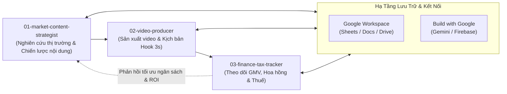

# AGENTS.md - Quy Tắc Vận Hành Hệ Thống AI Agent

Tài liệu này quy định các nguyên tắc bắt buộc, tiêu chuẩn kiến trúc và kỷ luật thực thi đối với tất cả các Agent hoạt động trong dự án **TikTok Affiliate AI Agent**.

---

## 1. Ba Nguyên Tắc Cốt Lõi Bất Khả Xâm Phạm (Non-Negotiable Rules)

### 🔴 Quy Tắc 1: Bắt Buộc Tái Sử Dụng Code Trong `src/`
- **Nguyên tắc**: Tuyệt đối **không viết lại** (duplicate) các hàm xử lý dữ liệu, logic kết nối, xác thực schema hoặc luồng công việc đã tồn tại.
- **Yêu cầu thực thi**:
  - Mọi logic dùng chung (helpers, formatting, logging, date utils, hashing) phải nằm trong [src/shared/](file:///c:/Users/hhaa/Documents/z/src/shared).
  - Mọi quy trình phối hợp liên Agent phải sử dụng các workflow trong [src/workflows/](file:///c:/Users/hhaa/Documents/z/src/workflows).
  - Trước khi viết mới bất kỳ chức năng nào, Agent bắt buộc phải kiểm tra thư mục `src/` xem đã có giải pháp tương tự hay chưa.
  - Khi tạo một hàm hữu ích có khả năng tái sử dụng cho Agent khác, phải đóng gói vào `src/shared/` hoặc `src/antigravity-connectors/`.

### 🔴 Quy Tắc 2: Nghiêm Cấm Tự Ý Cài Đặt Thư Viện Ngoài
- **Nguyên tắc**: Tuyệt đối **không tự ý cài đặt package bên thứ ba** (`npm install`, `pip install`, `yarn add`, `cargo add`, v.v.) vào dự án khi chưa có sự xác nhận và phê duyệt rõ ràng từ người dùng.
- **Yêu cầu thực thi**:
  - Tận dụng tối đa các thư viện tiêu chuẩn (built-in standard libraries) và các công cụ/MCP có sẵn trong môi trường Google Antigravity.
  - Trường hợp thực sự cần một thư viện ngoài để giải quyết bài toán đặc thù, Agent phải giải trình lý do, giải pháp thay thế, rủi ro tương thích và **hỏi ý kiến người dùng trước khi thực hiện**.

### 🔴 Quy Tắc 3: Mọi Kết Nối Dữ Liệu Phải Đi Qua Dịch Vụ Google Của Antigravity
- **Nguyên tắc**: Không tự ý tích hợp cơ sở dữ liệu lạ, server trung gian độc lập hoặc dịch vụ cloud bên thứ ba không được cấp phép. Mọi luồng dữ liệu vào/ra phải đi qua các connector được định nghĩa trong [src/antigravity-connectors/](file:///c:/Users/hhaa/Documents/z/src/antigravity-connectors).
- **Phân định dịch vụ**:
  1. **Google Workspace (`src/antigravity-connectors/google-workspace`)**:
     - **Google Sheets**: Nguồn dữ liệu bảng tính chính quản lý danh mục sản phẩm, bảng giá, tỷ lệ hoa hồng, tracking link, số liệu báo cáo GMV/CTR/CPS.
     - **Google Docs**: Quản lý tài liệu kịch bản video, bài viết mẫu, brief nội dung, content guidelines.
     - **Google Drive**: Lưu trữ tập trung tài nguyên media (video, ảnh sản phẩm, âm thanh, banner).
     - **Google Calendar**: Quản lý lịch trình xuất bản video, lịch livestream affiliate và lịch nhắc việc của đội ngũ.
  2. **Build with Google (`src/antigravity-connectors/google-build`)**:
     - **Gemini API**: Khả năng suy luận, phân tích xu hướng thị trường, tạo kịch bản Hook 3s, phân tích đánh giá người dùng.
     - **Firebase / Firestore**: Lưu trữ trạng thái phiên làm việc (state management), cache thời gian thực, queue điều phối giữa các Agent.
     - **Google Cloud Platform (GCP)**: Các dịch vụ bổ trợ chuẩn hóa hạ tầng theo hệ sinh thái Antigravity.

---

## 2. Phân Quyền & Nhiệm Vụ Của Từng Agent

| Agent | Thư mục | Trách nhiệm chính |
| :--- | :--- | :--- |
| **01-market-content-strategist** | [agents/01-market-content-strategist](file:///c:/Users/hhaa/Documents/z/agents/01-market-content-strategist) | Quét xu hướng thị trường TikTok, phân tích sản phẩm hot, xây dựng chiến lược nội dung affiliate và định hướng luồng công việc (quản lý trong `workflows/` và xuất kết quả tại `outputs/`). |
| **02-video-producer** | [agents/02-video-producer](file:///c:/Users/hhaa/Documents/z/agents/02-video-producer) | Biên soạn kịch bản chi tiết với Hook 3s tối ưu, phối hợp công cụ sản xuất video, tạo visual/audio và chuẩn bị tài nguyên media đăng tải. |
| **03-finance-tax-tracker** | [agents/03-finance-tax-tracker](file:///c:/Users/hhaa/Documents/z/agents/03-finance-tax-tracker) | Giám sát doanh thu GMV, đối soát hoa hồng CPS/CPC/CPA, quản lý chi phí, tính toán nghĩa vụ thuế và lập báo cáo tài chính tiếp thị liên kết. |

---

## 3. Quy Chuẩn Giao Tiếp & Luồng Dữ Liệu

---

## 4. Kiểm Soát Dữ Liệu & Bảo Mật

1. **Schema Validation**: Mọi dữ liệu chuyển đổi giữa các agent hoặc lưu vào cache phải tuân thủ nghiêm ngặt định dạng định nghĩa trong [data/schemas/](file:///c:/Users/hhaa/Documents/z/data/schemas).
2. **Không Lưu Thông Tin Nhạy Cảm**: Tuyệt đối không commit API keys, token, mật khẩu tài khoản trực tiếp vào mã nguồn. Sử dụng biến môi trường hoặc cơ chế bí mật được hỗ trợ.
3. **Cơ chế Cache**: Tận dụng thư mục [data/cache/](file:///c:/Users/hhaa/Documents/z/data/cache) cho các dữ liệu tạm (metadata xu hướng, cache truy vấn tạm thời), tự động dọn dẹp theo chính sách TTL.

---

## 5. Agent Skills

### Issue tracker

Issues live in GitHub Issues. See [docs/agents/issue-tracker.md](file:///c:/Users/hhaa/Documents/z/docs/agents/issue-tracker.md).

### Triage labels

Canonical five-role vocabulary (`needs-triage`, `needs-info`, `ready-for-agent`, `ready-for-human`, `wontfix`). See [docs/agents/triage-labels.md](file:///c:/Users/hhaa/Documents/z/docs/agents/triage-labels.md).

### Domain docs

Single-context (`GLOSSARY.md` + `docs/adr/` at root). See [docs/agents/domain.md](file:///c:/Users/hhaa/Documents/z/docs/agents/domain.md).

### Browser automation skills

Bộ kỹ năng điều khiển trình duyệt từ [browser-use/browser-use](https://github.com/browser-use/browser-use) tại [.agents/skills/browser-use/](file:///c:/Users/hhaa/Documents/z/.agents/skills/browser-use):
- `browser-use`: Điều khiển trình duyệt qua CDP/Accessibility tree, điều hướng ngầm và cào dữ liệu sản phẩm TikTok Shop.
- `cloud`, `open-source`, `qa`, `remote-browser`, `x402`: Hướng dẫn tích hợp Cloud, Python SDK, kiểm thử QA tự động và kết nối remote.

---

## 6. Bộ Kiểm Soát Chất Lượng Code Ponytail (Lazy Senior Dev Mode)

Dự án áp dụng bộ kiểm soát code [dietrichgebert/ponytail](https://github.com/dietrichgebert/ponytail) thông qua quy tắc [.agents/rules/ponytail.md](file:///c:/Users/hhaa/Documents/z/.agents/rules/ponytail.md) và cấu hình [.ponytail/config.json](file:///c:/Users/hhaa/Documents/z/.ponytail/config.json).

### Triết lý cốt lõi: *"The best code is the code never written"*
- **YAGNI**: Không viết các tính năng, tùy chọn, wrapper trừu tượng không được yêu cầu rõ ràng.
- **Diff nhỏ nhất hoàn chỉnh**: Ưu tiên tận dụng mã có sẵn trong `src/shared/`, thư viện chuẩn (stdlib) hoặc native platform APIs. Xóa code luôn tốt hơn thêm code.
- **Minh bạch rủi ro**: Cuối mỗi phản hồi hoặc thay đổi code, bắt buộc ghi chú ngắn gọn những gì đã bỏ qua/chưa kiểm tra và rủi ro tiềm ẩn.
- **Đánh dấu điểm rút gọn (Shortcuts)**: Mọi giải pháp tạm thời phải có comment chuẩn: `shortcut: <giới hạn>, <khi nào nâng cấp>`.

### Bộ kỹ năng Ponytail tích hợp:
- [`ponytail`](file:///c:/Users/hhaa/Documents/z/.agents/skills/ponytail): Chuyển đổi cấp độ kiểm soát (`lite`, `full`, `ultra`, `off`).
- [`ponytail-review`](file:///c:/Users/hhaa/Documents/z/.agents/skills/ponytail-review): Review chống over-engineering cho các thay đổi mã nguồn.
- [`ponytail-audit`](file:///c:/Users/hhaa/Documents/z/.agents/skills/ponytail-audit): Kiểm toán toàn diện chất lượng code, phát hiện phình to (bloat), mã chết và rủi ro tải.
- [`ponytail-debt`](file:///c:/Users/hhaa/Documents/z/.agents/skills/ponytail-debt): Thu thập sổ cái nợ kỹ thuật từ các comment `shortcut:`.
- [`ponytail-gain`](file:///c:/Users/hhaa/Documents/z/.agents/skills/ponytail-gain): Xem thống kê hiệu quả tinh giản code từ benchmark.
- [`ponytail-help`](file:///c:/Users/hhaa/Documents/z/.agents/skills/ponytail-help): Bảng tra cứu nhanh lệnh và cấp độ Ponytail.
