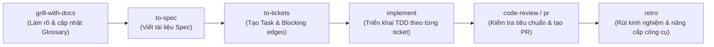

# TikTok Affiliate AI Agent System

Hệ thống đa tác nhân thông minh (**Multi-Agent AI System**) tự động hóa và tối ưu hóa toàn bộ quy trình tiếp thị liên kết trên nền tảng TikTok Shop, từ khâu nghiên cứu xu hướng thị trường & lập chiến lược nội dung, sản xuất video chuyển đổi cao với Hook 3s, cho đến theo dõi doanh thu GMV, đối soát hoa hồng và kế toán thuế.

---

## 📁 Cấu Trúc Thư Mục Dự Án

Chi tiết sơ đồ phân cấp và chức năng của từng thư mục trong dự án:

```
.
├── .agents/                                # Cấu hình và kỹ năng chuyên biệt của Agent
│   ├── rules/                              # Quy tắc vận hành tự động nạp cho Agent
│   │   └── ponytail.md                     # Quy tắc kiểm soát code Ponytail (Lazy Senior Dev)
│   ├── skills.json                         # Đăng ký các path quét kỹ năng cho Agent
│   └── skills/                             # Kho kỹ năng của hệ thống
│       ├── tiktok-domain/                  # Kỹ năng nghiệp vụ chuyên sâu TikTok Affiliate
│       │   ├── trend-research/             # Nghiên cứu xu hướng, hashtag, sản phẩm hot
│       │   ├── script-hook-writer/         # Viết kịch bản video & tối ưu Hook 3s
│       │   ├── link-tracker/               # Tạo, kiểm tra và theo dõi tracking link
│       │   └── roi-analyzer/               # Phân tích hiệu suất đầu tư & lợi nhuận
│       │
│       ├── [Ponytail Anti-Bloat Suite]     # Bộ kiểm soát code tinh gọn & chống over-engineering
│       │   ├── ponytail/                   # Chuyển đổi mức độ kiểm soát (lite/full/ultra/off)
│       │   ├── ponytail-review/            # Review code chống over-engineering
│       │   ├── ponytail-audit/             # Kiểm toán toàn bộ repository tìm bloat & rủi ro
│       │   ├── ponytail-debt/              # Sổ cái thu hoạch các comment shortcut:
│       │   ├── ponytail-gain/              # Thống kê hiệu quả tinh giản code từ benchmark
│       │   └── ponytail-help/              # Tra cứu nhanh lệnh và cấp độ Ponytail
│       │
│       ├── [Matt Pocock Skills Suite]      # Bộ kỹ năng quản lý dự án & kỹ thuật phần mềm chuẩn
│       │   ├── grill-with-docs/            # Phỏng vấn làm rõ bài toán, đồng bộ GLOSSARY & ADR
│       │   ├── to-spec/                    # Tổng hợp ngữ cảnh thành đặc tả chi tiết (Spec)
│       │   ├── to-tickets/                 # Phân rã Spec thành các ticket độc lập có blocking edges
│       │   ├── implement/                  # Triển khai từng ticket theo phương pháp TDD
│       │   ├── implement-spec/             # Điều phối triển khai toàn bộ Spec qua task graph
│       │   ├── triage/                     # Phân loại và gán nhãn issue vào hàng đợi
│       │   ├── retro/                      # Retrospective sau đợt phát triển để tối ưu môi trường
│       │   ├── handoff/                    # Đóng gói ngữ cảnh chuyển giao giữa các phiên làm việc
│       │   └── ...                         # Các kỹ năng: tdd, code-review, diagnosing-bugs, wayfinder, v.v.
│       │
│       └── [Browser Use Suite]             # Bộ kỹ năng tự động hóa và điều khiển trình duyệt qua CDP
│           ├── browser-use/                # Điều khiển trực tiếp trình duyệt, tương tác web, scraping
│           ├── cloud/                      # Tài liệu tham chiếu Browser Use Cloud API & SDK
│           ├── open-source/                # Tham chiếu thư viện mã nguồn mở browser-use cho Python
│           ├── qa/                         # Kiểm thử tự động chất lượng website & chấm điểm 1-5
│           ├── remote-browser/             # Điều khiển trình duyệt đám mây cách ly qua CLI
│           └── x402/                       # Thanh toán pay-per-use qua ví crypto cho Cloud Browser
│
├── .ponytail/                              # Cấu hình bộ kiểm soát code Ponytail
│   └── config.json                         # Thiết lập chế độ mặc định (defaultMode: full)
│
├── agents/                                 # Định nghĩa và mã nguồn vận hành của từng AI Agent
│   ├── 01-market-content-strategist/       # Agent nghiên cứu thị trường, sản phẩm hot & chiến lược nội dung
│   │   ├── workflows/                      # Quy trình phân tích, quét xu hướng & lập brief nội dung
│   │   └── outputs/                        # Báo cáo xu hướng, kế hoạch nội dung & kết quả khảo sát
│   ├── 02-video-producer/                  # Agent sản xuất video, kịch bản Hook 3s, prompt visual & media
│   └── 03-finance-tax-tracker/             # Agent theo dõi GMV, đối soát hoa hồng CPS & quản lý thuế
│
├── data/                                   # Quản lý dữ liệu và schema
│   ├── cache/                              # Lưu trữ bộ nhớ đệm tạm thời (temporary cache, TTL)
│   ├── schemas/                            # Định nghĩa cấu trúc dữ liệu chuẩn (JSON/Zod/Pydantic schemas)
│   └── tiktok-exports/                     # Dữ liệu xuất khẩu từ TikTok Shop, đơn hàng, hóa đơn & báo cáo
│
├── docs/                                   # Tài liệu dự án
│   ├── adr/                                # Architectural Decision Records (Quyết định kiến trúc)
│   ├── agents/                             # Hướng dẫn & cấu hình: domain.md, issue-tracker.md, triage-labels.md
│   └── specs/                              # Tài liệu đặc tả kỹ thuật, API và quy trình nghiệp vụ
│
├── src/                                    # Mã nguồn dùng chung và tầng tích hợp dịch vụ
│   ├── antigravity-connectors/             # Các bộ kết nối dịch vụ được cấp phép
│   │   ├── google-workspace/               # Kết nối Google Sheets, Docs, Drive, Calendar
│   │   └── google-build/                   # Kết nối Firebase, Gemini API, Chrome DevTools
│   ├── shared/                             # Các thư viện tiện ích, helpers dùng chung (bắt buộc tái sử dụng)
│   └── workflows/                          # Quy trình luồng phối hợp liên Agent (Pipelines & Workflows)
│
├── AGENTS.md                               # Quy tắc bắt buộc khi lập trình & vận hành Agent
├── GLOSSARY.md                             # Bảng thuật ngữ chuyên ngành TikTok Affiliate
└── README.md                               # Hướng dẫn tổng quan dự án
```

---

## 🤖 Chi Tiết Các AI Agent Trong Hệ Thống (`agents/`)

Hệ thống được tinh gọn thành 3 Agent chủ lực phụ trách toàn bộ chuỗi giá trị từ nghiên cứu đến tài chính:

### 1. `01-market-content-strategist`
- **Vai trò**: Nghiên cứu thị trường và hoạch định chiến lược nội dung affiliate.
- **Nhiệm vụ chính**:
  - Quét dữ liệu thị trường TikTok Shop: hashtag thịnh hành, âm thanh xu hướng, danh mục sản phẩm có tỷ lệ chuyển đổi cao.
  - Đánh giá uy tín Merchant, chính sách hoa hồng (%) và khả năng duyệt mẫu thử.
  - Lập chiến lược định vị nội dung, lịch đăng tải và brief kịch bản.
- **Cấu trúc nội bộ**:
  - `workflows/`: Định nghĩa các luồng công việc quét thị trường, lọc sản phẩm và lập kế hoạch tự động.
  - `outputs/`: Lưu trữ các báo cáo nghiên cứu xu hướng, bảng phân tích đối thủ và brief chiến lược đã hoàn thành.

### 2. `02-video-producer`
- **Vai trò**: Sản xuất nội dung video ngắn chuyển đổi cao.
- **Nhiệm vụ chính**:
  - Soạn kịch bản chi tiết với công thức **Hook 3s** (ngăn người xem lướt qua), thân bài giải quyết vấn đề và Call To Action (CTA) dẫn vào giỏ hàng vàng.
  - Tạo prompt hình ảnh/video cho các công cụ AI tạo sinh, phối hợp âm thanh thương mại thịnh hành.
  - Quản lý tài nguyên media (video, thumbnail, audio) trên Google Drive và hỗ trợ lên lịch phát hành video.

### 3. `03-finance-tax-tracker`
- **Vai trò**: Quản lý tài chính, đối soát hoa hồng và kế toán thuế tiếp thị liên kết.
- **Nhiệm vụ chính**:
  - Giám sát các chỉ số tài chính thời gian thực: tổng doanh thu hàng hóa (**GMV**), tỷ lệ click (**CTR**), chi phí trên mỗi đơn hàng (**CPS**) và hành động (**CPA**).
  - Đối soát dữ liệu đơn hàng và hoa hồng thực nhận từ các tệp xuất khẩu trong `data/tiktok-exports/`.
  - Theo dõi chi phí sản xuất, tính toán nghĩa vụ thuế thu nhập cá nhân/doanh nghiệp theo quy định hiện hành và lập báo cáo tài chính minh bạch trên Google Sheets.

---

## 📊 Quản Lý Dữ Liệu (`data/`)

- **`cache/`**: Lưu trữ tạm thời kết quả truy vấn, metadata xu hướng thị trường với cơ chế tự hủy (TTL) nhằm tối ưu chi phí token và tốc độ phản hồi.
- **`schemas/`**: Định nghĩa cấu trúc dữ liệu chuẩn hóa (TypeScript types / JSON schemas) cho sản phẩm, kịch bản, sự kiện lịch và giao dịch tài chính.
- **`tiktok-exports/`**: Thư mục lưu trữ tập trung các tệp dữ liệu xuất khẩu từ TikTok Shop Creator Center, TikTok Shop Affiliate Network (file CSV/Excel đơn hàng, danh sách hoàn tiền, báo cáo đối soát hoa hồng).

---

## 🪢 Bộ Kiểm Soát Code Ponytail (Lazy Senior Dev Mode)

Dự án tích hợp bộ kiểm soát code từ [dietrichgebert/ponytail](https://github.com/dietrichgebert/ponytail) nhằm giữ cho codebase luôn tinh gọn, triệt tiêu mã thừa và ngăn ngừa tình trạng over-engineering:

- **Triết lý**: *"The best code is the code you never wrote"*.
- **YAGNI**: Chỉ xây dựng những gì được yêu cầu rõ ràng; tận dụng tối đa `src/shared/`, thư viện chuẩn và CLI native của Antigravity.
- **Lệnh điều khiển**: `/ponytail` (chuyển chế độ: `lite`, `full`, `ultra`, `off`), `/ponytail-review`, `/ponytail-audit`, `/ponytail-debt`, `/ponytail-gain`, `/ponytail-help`.

---

## 🛠️ Bộ Kỹ Năng Quản Lý Dự Án (Matt Pocock Skills Suite)

Tích hợp bộ kỹ năng từ [mattpocock/skills](https://github.com/mattpocock/skills) vào [.agents/skills/](file:///c:/Users/hhaa/Documents/z/.agents/skills) để điều phối quy trình kỹ thuật phần mềm:



---

## 🌐 Bộ Kỹ Năng Tự Động Hóa Trình Duyệt (Browser Use Suite)

Dự án tích hợp bộ công cụ tự động hóa trình duyệt chuyên sâu từ [browser-use/browser-use](https://github.com/browser-use/browser-use) đặt tại [.agents/skills/](file:///c:/Users/hhaa/Documents/z/.agents/skills):

- [`browser-use`](file:///c:/Users/hhaa/Documents/z/.agents/skills/browser-use): Điều khiển trình duyệt trực tiếp qua Chrome DevTools Protocol (CDP), tương tác web qua cây Accessibility, điều hướng tab ngầm, cào dữ liệu sản phẩm TikTok và vượt qua các trang bảo vệ bot.
- [`cloud`](file:///c:/Users/hhaa/Documents/z/.agents/skills/cloud): Tài liệu hướng dẫn sử dụng API/SDK Cloud, stealth browser, proxy dân cư và giải CAPTCHA.
- [`open-source`](file:///c:/Users/hhaa/Documents/z/.agents/skills/open-source): Cẩm nang lập trình Python với thư viện `browser-use` (Agent, Controller, custom tools).
- [`qa`](file:///c:/Users/hhaa/Documents/z/.agents/skills/qa): Kiểm thử giao diện và luồng người dùng web, đánh giá chất lượng từ 1 đến 5 sao.
- [`remote-browser`](file:///c:/Users/hhaa/Documents/z/.agents/skills/remote-browser): Kết nối và điều khiển trình duyệt chạy trên hạ tầng remote.
- [`x402`](file:///c:/Users/hhaa/Documents/z/.agents/skills/x402): Hướng dẫn thanh toán theo lượt yêu cầu (pay-per-request) qua ví USDC trên Base mainnet.

---

## 📜 Tài Liệu Liên Quan

- 📘 [GLOSSARY.md](file:///c:/Users/hhaa/Documents/z/GLOSSARY.md): Định nghĩa chi tiết các thuật ngữ TikTok Affiliate (Merchant, Publisher, CPS, CPC, CTR, GMV, Hook 3s...).
- 📕 [AGENTS.md](file:///c:/Users/hhaa/Documents/z/AGENTS.md): Ba nguyên tắc cốt lõi, quy chuẩn phân quyền Agent & kết nối Google Services.
