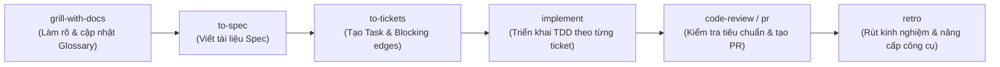

# TikTok Affiliate AI Agent System

Hệ thống đa tác nhân thông minh (**Multi-Agent AI System**) tự động hóa và tối ưu hóa toàn bộ quy trình tiếp thị liên kết trên nền tảng TikTok Shop, từ khâu khảo sát sản phẩm, tạo kịch bản video chuyển đổi cao, quản lý link affiliate cho đến tương tác người dùng và phân tích dữ liệu doanh thu.

---

## 📁 Cấu Trúc Thư Mục Dự Án

Chi tiết sơ đồ phân cấp và chức năng của từng thư mục trong dự án:

```
.
├── .agents/                                # Cấu hình và kỹ năng chuyên biệt của Agent
│   ├── rules/                              # Quy tắc vận hành tự động nạp cho Agent
│   │   └── ponytail.md                     # Quy tắc kiểm soát code Ponytail (Lazy Senior Dev)
│   ├── skills.json                         # Đăng ký các path quét kỹ năng cho Agent
│   └── skills/                             # Kho kỹ năng của hệ thống
│       ├── tiktok-domain/                  # Kỹ năng nghiệp vụ chuyên sâu TikTok Affiliate
│       │   ├── trend-research/             # Nghiên cứu xu hướng, hashtag, sản phẩm hot
│       │   ├── script-hook-writer/         # Viết kịch bản video & tối ưu Hook 3s
│       │   ├── link-tracker/               # Tạo, kiểm tra và theo dõi tracking link
│       │   └── roi-analyzer/               # Phân tích hiệu suất đầu tư & lợi nhuận
│       │
│       ├── [Ponytail Anti-Bloat Suite]     # Bộ kiểm soát code tinh gọn & chống over-engineering
│       │   ├── ponytail/                   # Chuyển đổi mức độ kiểm soát (lite/full/ultra/off)
│       │   ├── ponytail-review/            # Review code chống over-engineering
│       │   ├── ponytail-audit/             # Kiểm toán toàn bộ repository tìm bloat & rủi ro
│       │   ├── ponytail-debt/              # Sổ cái thu hoạch các comment shortcut:
│       │   ├── ponytail-gain/              # Thống kê hiệu quả tinh giản code từ benchmark
│       │   └── ponytail-help/              # Tra cứu nhanh lệnh và cấp độ Ponytail
│       │
│       ├── [Matt Pocock Skills Suite]      # Bộ kỹ năng quản lý dự án & kỹ thuật phần mềm chuẩn
│       │   ├── grill-with-docs/            # Phỏng vấn làm rõ bài toán, đồng bộ GLOSSARY & ADR
│       │   ├── to-spec/                    # Tổng hợp ngữ cảnh thành đặc tả chi tiết (Spec)
│       │   ├── to-tickets/                 # Phân rã Spec thành các ticket độc lập có blocking edges
│       │   ├── implement/                  # Triển khai từng ticket theo phương pháp TDD
│       │   ├── implement-spec/             # Điều phối triển khai toàn bộ Spec qua task graph
│       │   ├── triage/                     # Phân loại và gán nhãn issue vào hàng đợi
│       │   ├── retro/                      # Retrospective sau đợt phát triển để tối ưu môi trường
│       │   ├── handoff/                    # Đóng gói ngữ cảnh chuyển giao giữa các phiên làm việc
│       │   ├── ...                         # Các kỹ năng: tdd, code-review, diagnosing-bugs, wayfinder, v.v.
│
├── .ponytail/                              # Cấu hình bộ kiểm soát code Ponytail
│   └── config.json                         # Thiết lập chế độ mặc định (defaultMode: full)
│
├── agents/                                 # Định nghĩa và mã nguồn vận hành của từng AI Agent
│   ├── 01-merchant-scout/                  # Agent tìm kiếm và đánh giá Merchant & sản phẩm tiềm năng
│   ├── 02-network-manager/                 # Agent quản lý liên kết affiliate và mạng lưới tiếp thị
│   ├── 03-content-publisher/               # Agent sản xuất kịch bản, dựng nội dung & lên lịch đăng
│   ├── 04-consumer-engager/                # Agent tương tác bình luận & kích thích người tiêu dùng
│   └── 05-analytics-optimizer/             # Agent tổng hợp chỉ số (GMV, CTR, CPS) & tối ưu hóa ROI
│
├── data/                                   # Quản lý dữ liệu và schema
│   ├── cache/                              # Lưu trữ bộ nhớ đệm tạm thời (temporary cache, TTL)
│   └── schemas/                            # Định nghĩa cấu trúc dữ liệu chuẩn (JSON/Zod/Pydantic schemas)
│
├── docs/                                   # Tài liệu dự án
│   ├── adr/                                # Architectural Decision Records (Quyết định kiến trúc)
│   ├── agents/                             # Hướng dẫn & cấu hình: domain.md, issue-tracker.md, triage-labels.md
│   └── specs/                              # Tài liệu đặc tả kỹ thuật, API và quy trình nghiệp vụ
│
├── src/                                    # Mã nguồn dùng chung và tầng tích hợp dịch vụ
│   ├── antigravity-connectors/             # Các bộ kết nối dịch vụ được cấp phép
│   │   ├── google-workspace/               # Kết nối Google Sheets, Docs, Drive, Calendar
│   │   └── google-build/                   # Kết nối Firebase, Gemini API, Google Cloud
│   ├── shared/                             # Các thư viện tiện ích, helpers dùng chung (bắt buộc tái sử dụng)
│   └── workflows/                          # Quy trình luồng phối hợp liên Agent (Pipelines & Workflows)
│
├── AGENTS.md                               # Quy tắc bắt buộc khi lập trình & vận hành Agent
├── GLOSSARY.md                             # Bảng thuật ngữ chuyên ngành TikTok Affiliate
└── README.md                               # Hướng dẫn tổng quan dự án
```

---

## 🪢 Bộ Kiểm Soát Code Ponytail (Lazy Senior Dev Mode)

Dự án tích hợp bộ kiểm soát code từ [dietrichgebert/ponytail](https://github.com/dietrichgebert/ponytail) nhằm giữ cho codebase luôn tinh gọn, triệt tiêu mã thừa và ngăn ngừa tình trạng over-engineering:

### 1. Triết Lý & Nguyên Tắc Hoạt Động
- **"The best code is the code you never wrote"**: Đoạn code tốt nhất là đoạn code không cần phải viết.
- **YAGNI (You Aren't Gonna Need It)**: Từ chối các tính năng mở rộng hay cấu trúc trừu tượng khi chưa có yêu cầu cụ thể.
- **Diff tối thiểu hoàn chỉnh**: Ưu tiên tận dụng hàm dùng chung tại `src/shared/`, thư viện chuẩn hoặc native API trước khi nghĩ đến việc thêm thư viện hay tạo lớp trung gian.
- **Minh bạch phạm vi & rủi ro**: Luôn nêu rõ phần nào đã bỏ qua, phần nào chưa kiểm tra và rủi ro nếu có.

### 2. Danh Mục Kỹ Năng Ponytail
- [`ponytail`](file:///c:/Users/hhaa/Documents/z/.agents/skills/ponytail): Điều chỉnh mức độ kiểm soát (`lite`, `full`, `ultra`, `off`). Cấu hình mặc định là `full`.
- [`ponytail-review`](file:///c:/Users/hhaa/Documents/z/.agents/skills/ponytail-review): Kiểm tra thay đổi code hiện tại theo tiêu chí chống over-engineering, lỗi tiềm ẩn và tải thực tế.
- [`ponytail-audit`](file:///c:/Users/hhaa/Documents/z/.agents/skills/ponytail-audit): Kiểm toán chất lượng toàn diện cả repository, phát hiện bloat, mã chết và nợ kỹ thuật.
- [`ponytail-debt`](file:///c:/Users/hhaa/Documents/z/.agents/skills/ponytail-debt): Thu thập sổ cái nợ kỹ thuật từ các đánh dấu `shortcut: <giới hạn>, <khi nâng cấp>`.
- [`ponytail-gain`](file:///c:/Users/hhaa/Documents/z/.agents/skills/ponytail-gain): Xem thống kê tiết kiệm dòng code, chi phí và thời gian từ benchmark.
- [`ponytail-help`](file:///c:/Users/hhaa/Documents/z/.agents/skills/ponytail-help): Bảng tra cứu nhanh lệnh và cấp độ kiểm soát.

---

## 🛠️ Bộ Kỹ Năng Quản Lý Dự Án (Matt Pocock Skills Suite)

Hệ thống tích hợp bộ 27 kỹ năng từ repository [mattpocock/skills](https://github.com/mattpocock/skills) vào [.agents/skills/](file:///c:/Users/hhaa/Documents/z/.agents/skills):



- [`ask-matt`](file:///c:/Users/hhaa/Documents/z/.agents/skills/ask-matt): Bộ định tuyến chọn quy trình phù hợp.
- [`grill-with-docs`](file:///c:/Users/hhaa/Documents/z/.agents/skills/grill-with-docs): Phỏng vấn làm rõ thiết kế kiến trúc, cập nhật [GLOSSARY.md](file:///c:/Users/hhaa/Documents/z/GLOSSARY.md) và ghi nhận [docs/adr/](file:///c:/Users/hhaa/Documents/z/docs/adr).
- [`to-spec`](file:///c:/Users/hhaa/Documents/z/.agents/skills/to-spec): Đúc kết ngữ cảnh hội thoại thành bản đặc tả kỹ thuật hoàn chỉnh.
- [`to-tickets`](file:///c:/Users/hhaa/Documents/z/.agents/skills/to-tickets): Chia nhỏ Spec thành các ticket độc lập có ràng buộc chặn (*blocking edges*).
- [`implement`](file:///c:/Users/hhaa/Documents/z/.agents/skills/implement): Xử lý từng ticket theo phương pháp TDD.
- [`implement-spec`](file:///c:/Users/hhaa/Documents/z/.agents/skills/implement-spec): Điều phối subagent triển khai toàn bộ Spec dựa trên đồ thị tác vụ (task graph).
- [`tdd`](file:///c:/Users/hhaa/Documents/z/.agents/skills/tdd): Chu trình Red-Green-Refactor.
- [`code-review`](file:///c:/Users/hhaa/Documents/z/.agents/skills/code-review): Đánh giá chất lượng code diff trên 2 trục: Chuẩn code & Độ khớp Spec.
- [`diagnosing-bugs`](file:///c:/Users/hhaa/Documents/z/.agents/skills/diagnosing-bugs): Quy trình chẩn đoán lỗi kỷ luật.
- [`triage`](file:///c:/Users/hhaa/Documents/z/.agents/skills/triage): Phân loại issue bên ngoài theo 5 vai trò triage tiêu chuẩn.
- [`retro`](file:///c:/Users/hhaa/Documents/z/.agents/skills/retro): Đánh giá sau chu kỳ triển khai nhằm cải thiện môi trường làm việc của Agent.

---

## 🎯 Chức Năng Chi Tiết Từng Thư Mục Khác

### 1. `.agents/skills/tiktok-domain/`
- **`trend-research`**: Nghiên cứu xu hướng, âm thanh thịnh hành, hashtag và sản phẩm hot trên TikTok Shop.
- **`script-hook-writer`**: Sáng tạo kịch bản video ngắn, tối ưu Hook 3s và CTA giỏ hàng.
- **`link-tracker`**: Tự động sinh mã affiliate, rút gọn link và gắn tracking UTM.
- **`roi-analyzer`**: Phân tích tỷ suất sinh lời (ROI/ROAS), dự phóng doanh thu theo traffic & CTR.

### 2. `agents/`
- **`01-merchant-scout`**: Khảo sát thị trường, đánh giá uy tín Merchant, tỷ lệ duyệt mẫu và chính sách hoa hồng.
- **`02-network-manager`**: Quản lý liên kết tiếp thị, đối soát hoa hồng từ TikTok Shop Affiliate Network.
- **`03-content-publisher`**: Lên kịch bản chi tiết, sản xuất video và lên lịch đăng tải nội dung.
- **`04-consumer-engager`**: Phản hồi bình luận khán giả, giải đáp thắc mắc và kích hoạt quyết định mua sắm.
- **`05-analytics-optimizer`**: Giám sát GMV, CTR, CPS, CPA và phát hiện cơ hội tối ưu hóa toàn chuỗi.

### 3. `src/`
- **`antigravity-connectors/google-workspace/`**: Kết nối Google Sheets (sản phẩm/doanh thu), Google Docs (kịch bản), Google Drive (media), Google Calendar (lịch đăng).
- **`antigravity-connectors/google-build/`**: Kết nối Firebase (state/cache) và Gemini API (suy luận/sinh nội dung).
- **`shared/`**: Thư viện tiện ích dùng chung (bắt buộc tái sử dụng, không duplicate code).
- **`workflows/`**: Quy trình phối hợp liên tác tử (Pipelines).

### 4. `data/` & `docs/`
- **`data/cache/`**: Bộ nhớ đệm tạm thời theo cơ chế TTL.
- **`data/schemas/`**: Định nghĩa cấu trúc dữ liệu chuẩn giữa các Agent.
- **`docs/adr/`**: Lưu giữ các quyết định kiến trúc (Architecture Decision Records).
- **`docs/agents/`**: Cấu hình vận hành Agent ([domain.md](file:///c:/Users/hhaa/Documents/z/docs/agents/domain.md), [issue-tracker.md](file:///c:/Users/hhaa/Documents/z/docs/agents/issue-tracker.md), [triage-labels.md](file:///c:/Users/hhaa/Documents/z/docs/agents/triage-labels.md)).
- **`docs/specs/`**: Đặc tả kỹ thuật chi tiết của các tính năng.

---

## 📜 Tài Liệu Liên Quan

- 📘 [GLOSSARY.md](file:///c:/Users/hhaa/Documents/z/GLOSSARY.md): Định nghĩa chi tiết các thuật ngữ TikTok Affiliate.
- 📕 [AGENTS.md](file:///c:/Users/hhaa/Documents/z/AGENTS.md): Ba nguyên tắc cốt lõi & quy chuẩn vận hành hệ thống Agent.
